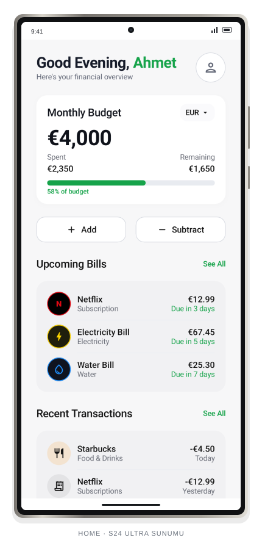
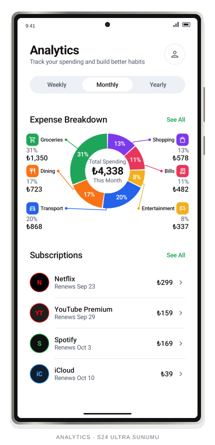

  

Android uygulamaları geliştiriyorum. **Kullanışlı arayüzlere, anlaşılır bilgilere ve günlük işleri kolaylaştıran deneyimlere** odaklanıyorum. Şu anda My Wallet üzerinde çalışıyorum.

## Üzerinde çalıştığım proje · My Wallet

Gelir, gider, fatura ve abonelikleri tek bir yerde bir araya getiren Android uygulamam. Amacım, günlük finans takibini daha anlaşılır ve kolay hale getirmek.

| Günlük takip | Akıllı veri girişi | Daha net bir görünüm |
| :--- | :--- | :--- |
| Bütçe, gelir ve gider yönetimi | Kamera ile fiş okuma | Kategorilere göre harcama analizi |
| Fatura ve abonelik takibi | Sesli gider ekleme | Açık/koyu tema ve ana ekran araçları |

### Uygulamadan iki görünüm

<table>
  <tr>
    <th width="50%">Bütçeye genel bakış</th>
    <th width="50%">Harcama analizi</th>
  </tr>
  <tr>
    <td align="center" valign="top"></td>
    <td align="center" valign="top"></td>
  </tr>
</table>

Görselleri tam boyutta incelemek için üzerlerine tıklayabilirsin.

**Geliştirme devam ediyor.** İndirme bağlantısı yayımlandığında burada paylaşacağım.

## Kullandığım teknolojiler

| Alan | Teknolojiler |
| :--- | :--- |
| Android arayüzü | Kotlin · Jetpack Compose · Material 3 |
| Veri ve arka plan işlemleri | Firebase · Room · Coroutines |
| Kamera ve akıllı özellikler | CameraX · ML Kit · Gemini AI |

---

My Wallet · Track. Save. Grow.

