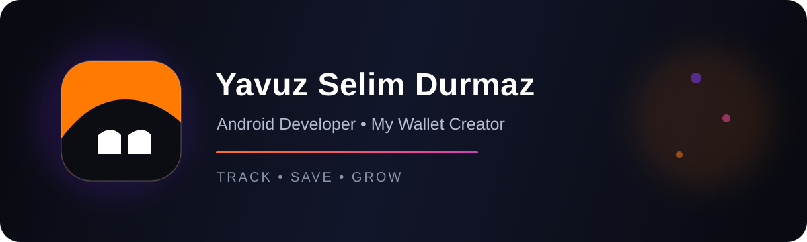
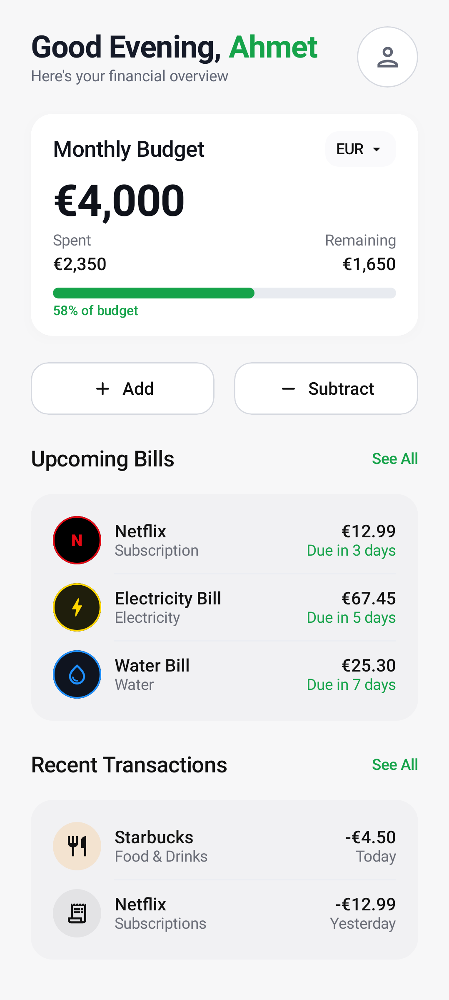
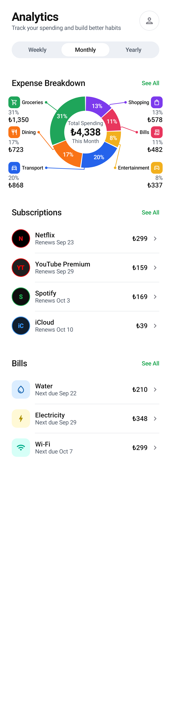

  

 

### Merhaba, ben Yavuz Selim 👋

Android uygulamaları geliştiriyor; sade, güvenli ve kullanışlı mobil deneyimler tasarlıyorum.

---

## 📱 My Wallet

**My Wallet**, günlük finans yönetimini kolaylaştırmak için geliştirdiğim modern bir Android uygulamasıdır.

- Gelir, gider ve bütçe takibi
- Fatura ve abonelik yönetimi
- Harcama analizleri ve grafikler
- Kamera ile fiş okuma ve akıllı sınıflandırma
- Sesli gider ekleme
- Firebase tabanlı güvenli veri altyapısı
- Açık/koyu tema ve Android ana ekran araçları

  
  &nbsp;&nbsp;
  

> 🚧 My Wallet aktif olarak geliştiriliyor. Güvenli indirme bağlantısı yayınlandığında bu sayfaya eklenecek.

---

## 🧰 Kullandığım teknolojiler

`Kotlin` · `Jetpack Compose` · `Material 3` · `Firebase` · `Room` · `Coroutines` · `CameraX` · `ML Kit` · `Gemini AI`

## 📊 GitHub istatistikleri

  
  

  Track · Save · Grow — My Wallet

